

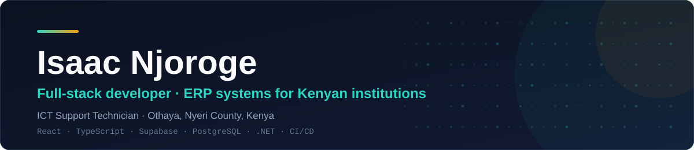

 

 


 

Tell me what you need. A short form, no sign-up beyond GitHub.

## About

I design, build and support **complete management systems for Kenyan institutions**: churches, hospitals and
public-sector offices that need software their staff can run every day. I take a project from the data model
and permissions, through the web and desktop apps, payments and messaging, to automated releases, and then
I stay on to support the people using it.

My day job is **ICT support** (Tier 1 and 2, HIS/MIS and clinical environments), so I build with the help desk
in mind: clear errors, safe defaults, audit trails, and an off switch for any feature that misbehaves.

| | |
| --- | --- |
| **Focus** | ERP and management systems for Kenyan institutions |
| **Delivered** | A parish ERP with several separate sites and a Windows desktop suite · a hospital procurement ERP on web and desktop |
| **Stack** | React, TypeScript, Supabase / PostgreSQL, .NET (WPF), Electron, GitHub Actions |
| **Based in** | Othaya, Nyeri County, Kenya |
| **Currently** | Building and extending **Kanyange Connect**: the ERP, its Windows apps and its operations tooling |

## What I can build for you


## Work I've delivered

<table>
<tr>
<td width="50%" valign="top">

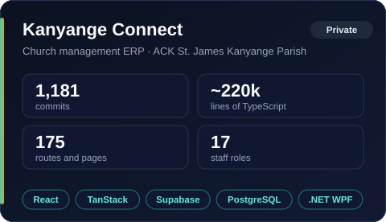

</td>
<td width="50%" valign="top">

<a href="https://github.com/huiejorjdsksfn/medi-procure-hub">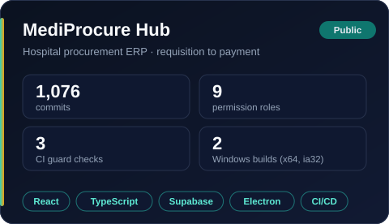</a>

</td>
</tr>
</table>

### Case study: Kanyange Connect, a parish ERP for ACK St. James Kanyange

| | |
| --- | --- |
| **The brief** | One system for a parish: public website, member portal, staff portal, administration and finance, each with its own address and sign-in, all on one shared database. |
| **What I built** | Member register and sign-up forms with QR codes · giving and treasury ledger, budgets, bank records and requisitions · **M-Pesa** and **Equity Jenga** payment callbacks · attendance registers and a data-entry desk with an approval queue · certificates · a weekly bulletin studio with print layout · a Windows suite (.NET / WPF): an office-PC sync server with nightly backups, an admin console and an offline-capable front-desk member app, shipped with an installer and NuGet packages. |
| **How it stays safe** | 17 staff roles enforced in the database (row-level security), authenticator-app second step, bot protection on sign-in, audit and sign-in logs with automatic clean-up, and an on/off switch for every site and page. |
| **How it stays reliable** | 130+ automated test files, including tests that read the real import graph to keep the sites isolated from each other · 15 CI workflows · a deploy preflight that type-checks and builds before anything ships. |
| **Scale** | 1,000+ commits since August 2026 · about 220,000 lines of TypeScript · 175 route files · 415 components · 220+ database migrations. |

### Case study: MediProcure Hub, procurement for a hospital · [repository](https://github.com/huiejorjdsksfn/medi-procure-hub)

| | |
| --- | --- |
| **The brief** | Run the whole procurement chain digitally, with the approvals and paperwork a hospital needs. |
| **What I built** | Requisitions → purchase orders → goods received → tenders → contracts → payment, receipt and journal vouchers · 3-way invoice matching · a document studio with signatures and stamps · WhatsApp notifications through a self-hosted gateway · a resilient network layer (circuit breaker and priority queue). |
| **How it stays safe** | 9-role permission model, a security review of a live system, and one-time-code sign-in. |
| **How it stays reliable** | Three permanent CI guards (undefined references, temporal-dead-zone errors, database schema drift) · Electron desktop builds for Windows x64 and ia32 released automatically by GitHub Actions. |

## Capabilities, and where each is proven

| Area | Hands-on experience | Proven in |
| --- | --- | --- |
| **Front end** | React, TypeScript, TanStack Start / Router / Query, Vite, Tailwind CSS 4, shadcn/Radix UI, Zod forms, Recharts, three.js, print-ready and PDF layouts | Both systems |
| **Back end and data** | PostgreSQL design, row-level security, SQL functions (RPC), triggers, views, `pg_cron` jobs, Supabase Auth, Storage, Realtime and Edge Functions, server routes and webhooks | Kanyange Connect (220+ migrations) |
| **Security and access** | Role and permission models, least-privilege grants, authenticator-app 2FA, audit trails, session controls, bot protection, database-exposure reviews | Kanyange Connect · MediProcure Hub |
| **Integrations** | M-Pesa, Equity Jenga, email (Resend, SMTP), WhatsApp gateway, Google Forms and Sheets sync, QR codes, ODBC / PostgreSQL migration and sync tooling | Both systems |
| **Desktop** | .NET / WPF suites with installers and NuGet packaging, Electron apps, printer detection | Kanyange Connect (WPF) · MediProcure Hub (Electron) |
| **Delivery** | GitHub Actions CI/CD, deploy preflight checks, Docker, Tencent EdgeOne Pages, Bun and pnpm, release automation | 15 workflows in Kanyange Connect |
| **Quality** | Guard tests over the real import graph, a regression test for every bug fixed, schema-drift and undefined-reference checks, TypeScript in its strictest mode | 130+ test files |
| **IT support** | Tier 1 and 2 support, hospital information systems (HIS/MIS), clinical-environment workflows, user training, documentation, incident handling | Day-to-day work |

## 2026 delivery timeline


## How I deliver

| Step | What happens | What you get |
| --- | --- | --- |
| **1. Understand** | Map the real workflow, approvals and reports with the people who will use the system. | A clear scope and the first screens to react to |
| **2. Model** | Design the data and permissions first: who can see what, who approves what, what is logged. | A schema and role matrix you can review |
| **3. Build** | Ship in small releases, with payments and messaging wired in early and every feature behind an off switch. | Working software at every stage |
| **4. Verify** | Type-checking, guard tests, a deploy preflight and a real build before anything goes live. | Releases that don't break what already works |
| **5. Hand over** | Documentation, runbooks, training and ongoing support. | A system your team can run |

## Delivery record, live from GitHub


 


 


 


 


## Let's talk

Have a system to build, fix or modernise? Describe it in a few lines and I will reply with questions and a
suggested next step.

GitHub issues are public, so please keep phone numbers and private data out of the form. I will reply and suggest a private way to continue.

  

Cards are drawn from my GitHub data by <a href="scripts/generate-stats.mjs"><code>scripts/generate-stats.mjs</code></a> · figures in <a href="data/projects.json"><code>data/projects.json</code></a> and <a href="data/history.json"><code>data/history.json</code></a>.

